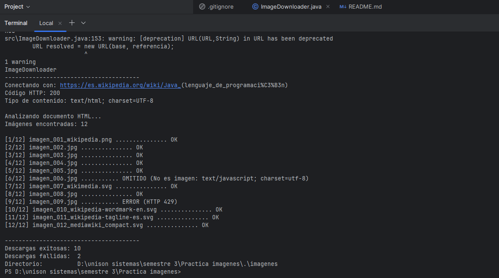

# ImageDownloader

Aplicación de consola en Java para la descarga automatizada de imágenes desde páginas web utilizando exclusivamente la API estándar (`URL`, `URLConnection` y `HttpURLConnection`), cumpliendo con los requisitos de la práctica.

## Requisitos
- JDK 17 o superior.
- IntelliJ IDEA (opcional para desarrollo).

## Compilación y Ejecución

Compilar el archivo fuente:
```bash
javac src/main/java/ImageDownloader.java

PREGUNTAS DE REFLEXION 
¿Qué responsabilidad desempeña la aplicación dentro de una arquitectura cliente-servidor?
Actúa como un cliente HTTP que realiza solicitudes (GET) a un servidor web para obtener un documento HTML y posteriormente solicita de forma individual cada recurso de imagen referenciado.   ¿Qué diferencias existen entre URL, URLConnection y HttpURLConnection?
URL representa la dirección lógica del recurso; URLConnection es una clase abstracta genérica para manejar la comunicación con el recurso; y HttpURLConnection es una subclase específica para el protocolo HTTP que permite gestionar códigos de estado, cabeceras y métodos de solicitud.   ¿Qué sucede al invocar openConnection()?
Se crea un objeto de conexión vinculado a la URL, pero no se establece comunicación de red efectiva en ese instante.   ¿Qué operaciones provocan que la conexión se establezca realmente?
Invocaciones que requieren datos del servidor, tales como connect(), getResponseCode() o getInputStream().   ¿Por qué una página web puede requerir múltiples conexiones?
Porque el documento HTML principal contiene referencias a recursos externos independientes (como imágenes, hojas de estilo o scripts) que deben solicitarse uno por uno al servidor.   ¿Cuál es la diferencia entre getInputStream() y getContentType()?
getInputStream() abre el flujo binario de datos del recurso remoto, mientras que getContentType() devuelve una cadena con el tipo MIME del contenido (ej. text/html, image/png) obtenido de las cabeceras HTTP.   ¿Por qué distinguir recursos textuales y binarios?
Porque los recursos textuales (HTML) se procesan interpretando codificaciones de caracteres (como UTF-8) mediante lectores de texto, mientras que los binarios (imágenes) deben transferirse byte a byte sin alteración para evitar corrupción de datos.   ¿Para qué sirven los tiempos máximos de conexión y lectura?
Para evitar que la aplicación se quede bloqueada indefinidamente si el servidor responde con extrema lentitud o no está disponible.   ¿Qué limitaciones tiene analizar HTML mediante expresiones regulares?
Las expresiones regulares no forman un analizador sintáctico completo (parser), por lo que pueden fallar ante marcado HTML malformado, atributos desordenados, comentarios complejos o contenido dinámico generado por JavaScript.   ¿Cómo podría implementarse la descarga concurrente usando únicamente la API estándar de Java?
Utilizando un ExecutorService con un pool de hilos (Executors.newFixedThreadPool) para procesar la descarga de cada imagen en paralelo de manera segura y controlada[cite: 3].

## Evidencia de Funcionamiento
